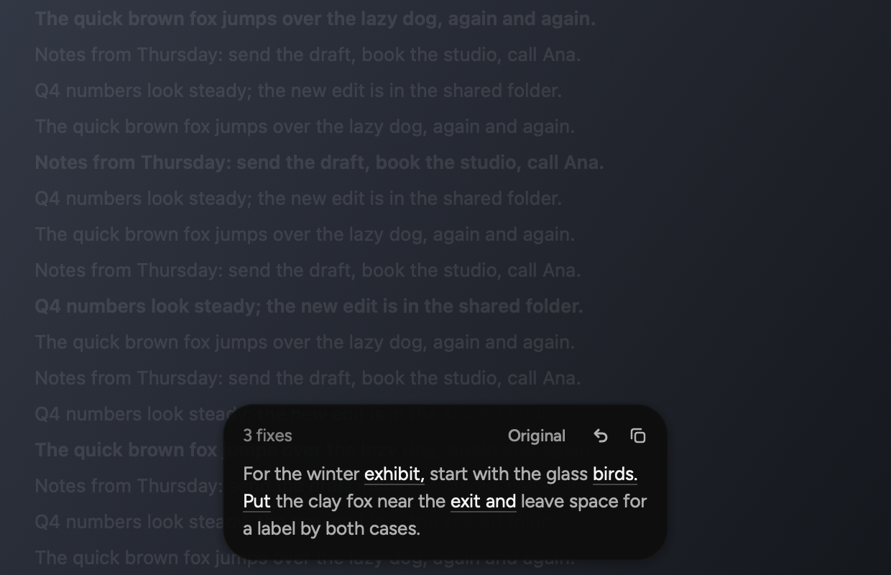
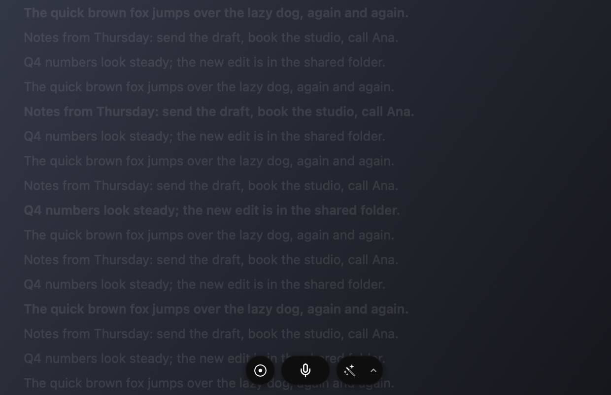
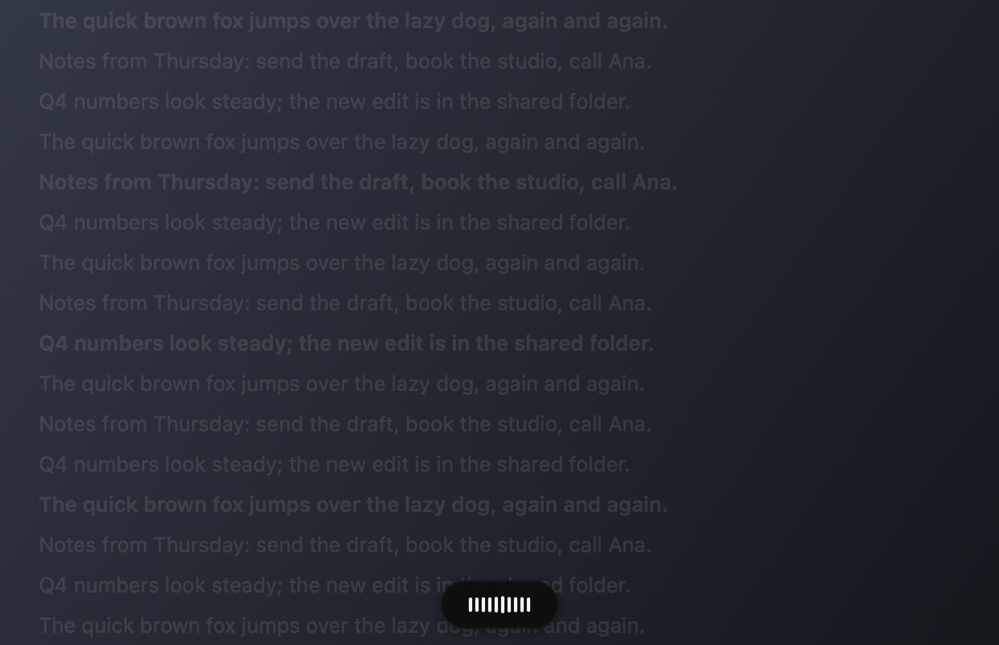
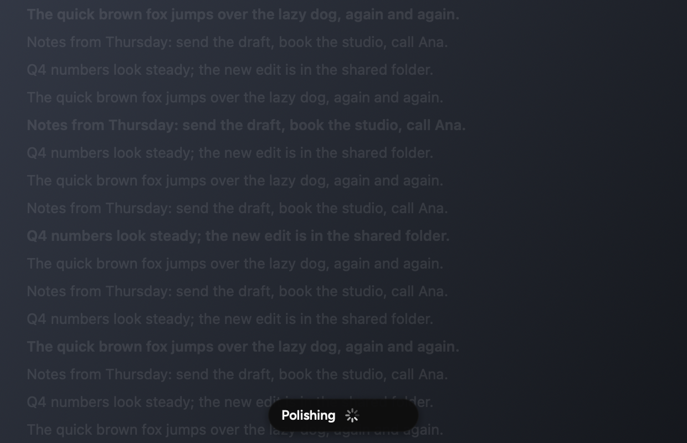
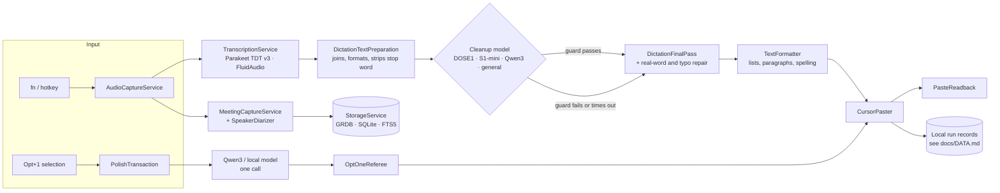

# FLOW

Flow is a local-first macOS menu bar app for dictation, selected-text polish (Opt+1) and meeting capture. Speech recognition, cleanup and the rule passes run on your Mac by default. Cloud cleanup providers exist, but they are opt-in and need your own API keys.

Cleanup checks protect details such as names, numbers and negations. If a rewrite fails a check, Flow falls back to the earlier text.



| Ready | Listening | Polishing |
| --- | --- | --- |
|  |  |  |

Rendered offscreen by FLOW with a sample desktop and generated audio levels.

## Features

- **Push-to-talk dictation.** Hold the fn key (or a configured hotkey) to talk; release to paste at the cursor. A double tap locks recording; a further tap stops it. See `Sources/Voice/Services/HotkeyService.swift` and `Sources/Voice/Services/FnKeyTap.swift`.
- **Paste with a readback check.** After pasting, Flow reads the field back through Accessibility and reports whether the text landed (`Sources/Voice/Utils/PasteReadback.swift`).
- **On-device speech recognition.** Parakeet TDT 0.6B v3 through FluidAudio is the default. Other engines are listed in `Sources/Voice/Services/SpeechModelCatalog.swift`. See [docs/ENGINE.md](docs/ENGINE.md).
- **Layered cleanup.** A local cleanup model tidies punctuation, fillers and self-corrections. Each output must pass a content guard (numbers, names, links, negations, coverage) before it is used.
- **Rule passes.** Filler and stutter removal, real-word homophone fixes, typo repair, low-confidence rechecks and American spelling. See [docs/ARCHITECTURE.md](docs/ARCHITECTURE.md).
- **Opt+1 polish.** Polishes the selected text once and replaces it once. Undo restores the original only when the text is unchanged since Flow wrote it (`Sources/Voice/Services/PolishTransaction.swift`).
- **Meetings.** Captures meeting audio, separates speakers, stores transcripts in a local SQLite database with full-text search, and exports them. A Chrome extension can start and stop capture when a Google Meet call begins or ends (`Extension/`).
- **Local by default, with a master switch.** Run records, traces and events are written only to your Mac. A privacy-mode switch turns the logging off. See [docs/DATA.md](docs/DATA.md).

## Architecture



The diagram follows the order in `Sources/Voice/Services/DictationTextPreparation.swift` and `Sources/Voice/Services/RecordingCoordinator.swift`. The full stage list, deadlines and fallbacks are in [docs/ARCHITECTURE.md](docs/ARCHITECTURE.md).

## Requirements

- macOS 26 or later (`Package.swift` sets `.macOS("26.0")`).
- Apple silicon is recommended: the local models run on Core ML and MLX.
- Xcode with the Swift 6.2 toolchain (`// swift-tools-version: 6.2`).
- Microphone and Accessibility permissions. Calendar access is optional, for meeting titles.
- Optional: `llama-server` from llama.cpp for the GGUF cleanup models (DOSE1 and general models). Flow looks for it in the app bundle, then in `~/homebrew/bin`, `/opt/homebrew/bin` and `/usr/local/bin` (`Sources/Voice/Services/WhisperNowTunedPolisher.swift`).
- Optional: Python 3 with the MLX packages, for the Granite and Moonshine speech servers (`Sources/Voice/Resources/granite_server.py`, `moonshine_server.py`).

## Quick start

From the repository root, build the Swift package with:

```sh
swift build
```

See [ENGINE.md](docs/ENGINE.md) for model setup. The package build produces a command-line executable. For a macOS app bundle, see [build-install.sh](scripts/build-install.sh), which installs into `/Applications`.

`project.yml` is an XcodeGen description of the same targets. Run `xcodegen generate` if you prefer an Xcode project. Set `CODE_SIGN_IDENTITY` in `project.yml` to your own signing identity; the default `-` signs ad hoc, and macOS may ask for the permissions again after each rebuild (see the comment in `project.yml`).

## Models

Flow downloads most speech models on first use. Locations come from the manifests in `Sources/Voice/Resources/ModelManifests/`.

| Model | Used for | Source | Licence (see [THIRD_PARTY.md](THIRD_PARTY.md)) |
|---|---|---|---|
| Parakeet TDT 0.6B v3 (Core ML) | Default speech recognition | `FluidInference` conversions on Hugging Face (through FluidAudio) | NVIDIA Parakeet terms; check the model card |
| Parakeet Ultra, Phonon 2 (Core ML) | Optional recognisers | `FluidInference/parakeet-ultra-coreml`, `FluidInference/phonon-2-coreml` | Check each model card |
| S1-mini 4-bit (MLX) | Fallback cleanup | `mlx-community/S1-mini-MLX-4bit`; original by Superwhisper | Apache-2.0 plus an additional naming term; see `Sources/Voice/Resources/ModelNotices/S1-mini/` |
| Qwen3 (MLX, 4-bit) | Optional cleanup route | `mlx-community/Qwen3-1.7B-4bit` and others | Apache-2.0 (Qwen3); check the card |
| WhisperNow LFM3 1.7B fine-tune, GGUF (DOSE1) | Default cleanup | Not distributed here. Served by `llama-server` from a GGUF you supply | Depends on the base model licence |
| Granite 4.0 1B Speech (MLX) | Optional recogniser | `mlx-community/granite-4.0-1b-speech-5bit` | Apache-2.0 (IBM Granite); check the card |
| Moonshine Tiny (MLX) | Optional recogniser | `mlx-community/moonshine-tiny` | Check the card |
| TinyFix real-word weights (`tinyfix.bin`) | Homophone fixes | paperweight/tinyfix on Hugging Face | MIT. Not included here |
| tinynext v2 (`tinynext-v2.q8`) | Context scoring | paperweight/tinynext on Hugging Face | MIT. Not included here |

Cloud cleanup (Cerebras, Groq, Hyperbolic, NVIDIA) is opt-in. Each needs your own API key, which is stored in the macOS Keychain, and the provider's terms apply.

## What is not included

This export leaves out, on purpose:

- model weights and quantised binaries, fonts, sounds and app artwork (their licences need checking before redistribution);
- the word-frequency list used by the typo repair (`words.txt`), whose licence is not yet confirmed;
- the companion app. Flow can run alone; the optional integration is in `Sources/Voice/Services/FlowCommandListener.swift`;
- training data, run records and evaluation outputs, all of which hold private text.

Some tests read fixtures that are absent here. Those tests skip themselves when a fixture is missing.

The bundled typo dictionary contains three invented example pairs.

## Documentation

- [docs/ARCHITECTURE.md](docs/ARCHITECTURE.md): the dictation, Opt+1 and meeting pipelines, with fallbacks and deadlines.
- [docs/ENGINE.md](docs/ENGINE.md): speech and cleanup engines, model selection and the local server processes.
- [docs/DECISION-MODELS.md](docs/DECISION-MODELS.md): every guard, referee and decision model, with its thresholds and why it exists.
- [docs/DATA.md](docs/DATA.md): what Flow writes to disk, and how to turn it off.
- [docs/TRAINING.md](docs/TRAINING.md): the training and dataset scripts.
- [CONTRIBUTING.md](CONTRIBUTING.md): how to build, test and contribute without leaking private text.
- [THIRD_PARTY.md](THIRD_PARTY.md): dependencies, models and their licences.

## Licence

Flow is released under the MIT licence (see [LICENSE](LICENSE)). Third-party components keep their own licences, listed in [THIRD_PARTY.md](THIRD_PARTY.md).
