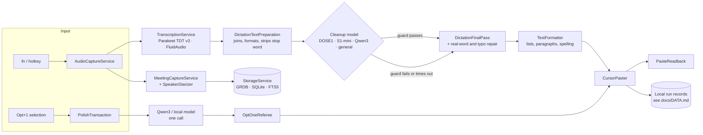

# FLOW for macOS

FLOW is an open-source, local-first voice app for **push-to-talk dictation, selected-text editing, and meeting transcription**. Hold a hotkey to dictate where you're typing, press **Option-1** to polish a selection, or record and search a meeting transcript with speaker labels.

Speech recognition and text cleanup run on your Mac by default. Cleanup checks protect details such as names, numbers, and negations. If a rewrite fails a check, FLOW falls back to the earlier text. Optional cloud cleanup uses your own API key.

[Build from source](#quick-start) · [How it works](#architecture) · [Data and privacy](docs/DATA.md) · [Contributing](CONTRIBUTING.md)


| Ready | Listening | Polishing |
| --- | --- | --- |
|  |  |  |

Rendered offscreen by FLOW with a sample desktop and generated audio levels.

## Quick start

This is a source release. Use **macOS 26 or later** and Xcode with the **Swift 6.2** toolchain. Apple silicon is recommended for the on-device Core ML and MLX models.

```sh
git clone https://github.com/fortun8te/t5-t5p.git flow-voice
cd flow-voice
swift build
```

For a menu bar app bundle, install [XcodeGen](https://github.com/yonaskolb/XcodeGen), run `xcodegen generate`, and open the generated project. Select the **Voice** scheme and run it from Xcode. The project uses ad-hoc signing by default. macOS may prompt for permissions again after a rebuild. See [project.yml](project.yml) for signing settings.

Grant **Microphone** for dictation and **Accessibility** for pasting and reading back text. Calendar access is optional and supplies meeting titles. The first use of a speech engine may need an internet connection to download its model. [Model setup](docs/ENGINE.md) covers available engines, optional dependencies, and what falls back if a model is unavailable.

If you are exploring the code, start with the [documentation index](docs/README.md). Run `swift test` for the Swift tests. [Contributing](CONTRIBUTING.md) explains fixture-dependent tests and the privacy rules for examples.

## Features

- **Push-to-talk dictation.** Hold the fn key (or a configured hotkey) to talk; release to paste at the cursor. A double tap locks recording; a further tap stops it. See `Sources/Voice/Services/HotkeyService.swift` and `Sources/Voice/Services/FnKeyTap.swift`.
- **Paste with a readback check.** After pasting, Flow reads the field back through Accessibility and reports whether the text landed (`Sources/Voice/Utils/PasteReadback.swift`).
- **On-device speech recognition.** Parakeet TDT 0.6B v3 through FluidAudio is the default. Other engines are listed in `Sources/Voice/Services/SpeechModelCatalog.swift`. See [docs/ENGINE.md](docs/ENGINE.md).
- **Layered cleanup.** A local cleanup model tidies punctuation, fillers and self-corrections. Each output must pass a content guard (numbers, names, links, negations, coverage) before it is used.
- **Rule passes.** Filler and stutter removal, real-word homophone fixes, typo repair, low-confidence rechecks and American spelling. See [docs/ARCHITECTURE.md](docs/ARCHITECTURE.md).
- **Opt+1 polish.** Polishes the selected text once and replaces it once. Undo restores the original only when the text is unchanged since Flow wrote it (`Sources/Voice/Services/PolishTransaction.swift`).
- **Meetings.** Captures meeting audio, separates speakers, stores transcripts in a local SQLite database with full-text search, and exports them. A Chrome extension can start and stop capture when a Google Meet call begins or ends (`Extension/`).
- **Local by default, with a master switch.** Run records, traces and events are written only to your Mac. A privacy-mode switch turns the logging off. See [docs/DATA.md](docs/DATA.md).

## Architecture



The diagram follows the order in `Sources/Voice/Services/DictationTextPreparation.swift` and `Sources/Voice/Services/RecordingCoordinator.swift`. The full stage list, deadlines and fallbacks are in [docs/ARCHITECTURE.md](docs/ARCHITECTURE.md).

## Models

Flow downloads most speech models on first use. Locations come from the manifests in `Sources/Voice/Resources/ModelManifests/`.

| Model | Used for | Source | Licence (see [THIRD_PARTY.md](THIRD_PARTY.md)) |
|---|---|---|---|
| Parakeet TDT 0.6B v3 (Core ML) | Default speech recognition | `FluidInference` conversions on Hugging Face (through FluidAudio) | NVIDIA Parakeet terms; check the model card |
| Parakeet Ultra, Phonon 2 (Core ML) | Optional recognisers | `FluidInference/parakeet-ultra-coreml`, `FluidInference/phonon-2-coreml` | Check each model card |
| S1-mini 4-bit (MLX) | Fallback cleanup | `mlx-community/S1-mini-MLX-4bit`; original by Superwhisper | Apache-2.0 plus an additional naming term; see `Sources/Voice/Resources/ModelNotices/S1-mini/` |
| Qwen3 (MLX, 4-bit) | Optional cleanup route | `mlx-community/Qwen3-1.7B-4bit` and others | Apache-2.0 (Qwen3); check the card |
| WhisperNow LFM3 1.7B fine-tune, GGUF (DOSE1) | Default cleanup | Not distributed here. Served by `llama-server` from a GGUF you supply | Depends on the base model licence |
| Granite 4.0 1B Speech (MLX) | Optional recogniser | `mlx-community/granite-4.0-1b-speech-5bit` | Apache-2.0 (IBM Granite); check the card |
| Moonshine Tiny (MLX) | Optional recogniser | `mlx-community/moonshine-tiny` | Check the card |
| TinyFix real-word weights (`tinyfix.bin`) | Homophone fixes | paperweight/tinyfix on Hugging Face | MIT. Not included here |
| tinynext v2 (`tinynext-v2.q8`) | Context scoring | paperweight/tinynext on Hugging Face | MIT. Not included here |

Cloud cleanup (Cerebras, Groq, Hyperbolic, NVIDIA) is opt-in. Each needs your own API key, which is stored in the macOS Keychain, and the provider's terms apply.

## Source release and privacy

The source release includes the macOS app, the optional [Google Meet Chrome extension](Extension/), training and evaluation tooling, and invented test fixtures. Model weights, audio, private training data, run records, and evaluation outputs stay outside the repository. Some tests skip when their optional fixtures or model assets are absent. The private DOSE1 weights are unavailable in this release, and the app can fall back to S1-mini.

The export also omits bundled fonts, sounds, app artwork, and the optional word-frequency file. FLOW runs standalone, with an optional companion integration in [FlowCommandListener.swift](Sources/Voice/Services/FlowCommandListener.swift). See [third-party notices](THIRD_PARTY.md) for model and asset terms.

Run records are local and can contain transcript text. [Data and privacy](docs/DATA.md) explains which files are written, how to disable run records, and what privacy mode does.

## Documentation

- [Architecture](docs/ARCHITECTURE.md) covers the dictation, selected-text polish, and meeting pipelines.
- [Engines and model setup](docs/ENGINE.md) covers speech and cleanup engines, optional dependencies, and fallback behavior.
- [Decision models](docs/DECISION-MODELS.md) covers the guards, decisions, and thresholds.
- [Data and privacy](docs/DATA.md) covers local storage, settings, and what leaves the Mac with optional cloud cleanup.
- [Training and evaluation](docs/TRAINING.md) covers the benchmark and dataset scripts.
- [Contributing](CONTRIBUTING.md) covers builds, tests, and the use of invented fixtures.

## Licence

Flow is released under the MIT licence (see [LICENSE](LICENSE)). Third-party components keep their own licences, listed in [THIRD_PARTY.md](THIRD_PARTY.md).
